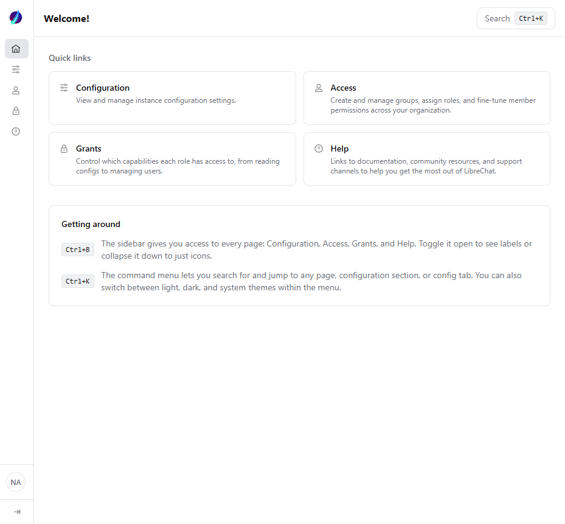
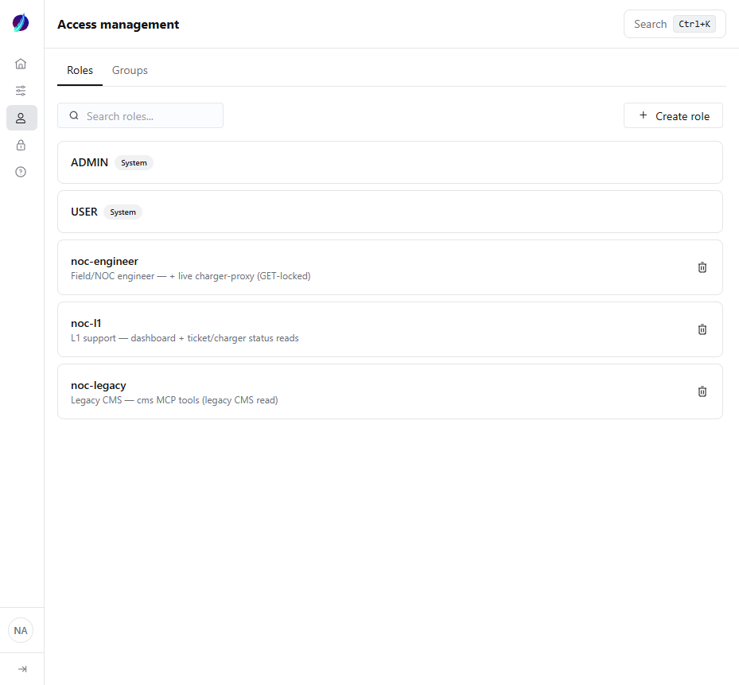
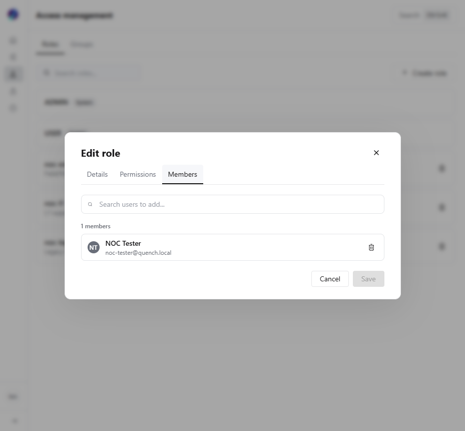
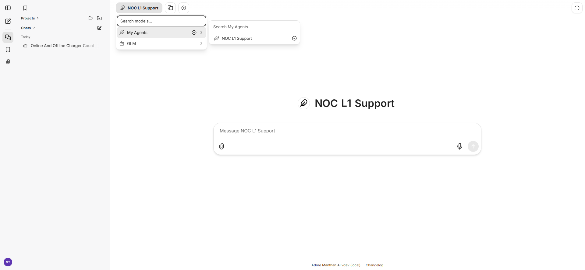
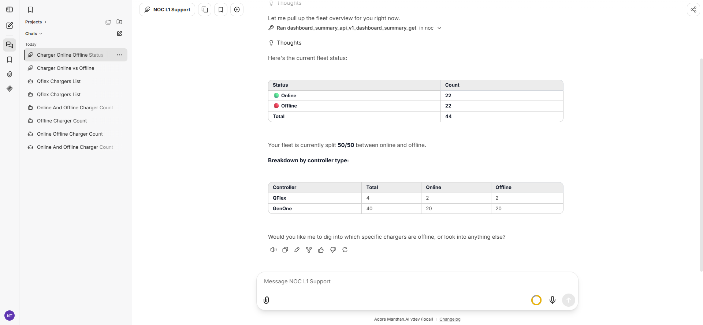

# Ador Manthan.AI — Administrator Manual

_How the platform works under the hood, and how an administrator adds tools, knowledge,
agents, models, users, and whole new departments — with the isolation between them._

**Audience:** platform administrators. **Companion docs:** [`manthan-overview.md`](manthan-overview.md)
(architecture reference), [`ADMIN-ACCESS.md`](ADMIN-ACCESS.md) (accounts & roles reference),
[`../apps/ai-platform/librechat/RUNBOOK.md`](../apps/ai-platform/librechat/RUNBOOK.md) (running the stack).

**Last updated:** 2026-07-21

---

## Contents

1. [The five building blocks](#1-the-five-building-blocks)
2. [Flow A — What happens when a user asks a question](#2-flow-a--what-happens-when-a-user-asks-a-question)
3. [Flow B — Adding an MCP server (a new set of tools)](#3-flow-b--adding-an-mcp-server-a-new-set-of-tools)
4. [Flow C — Creating an agent](#4-flow-c--creating-an-agent)
5. [Flow D — Giving an agent its own knowledge base](#5-flow-d--giving-an-agent-its-own-knowledge-base)
6. [Flow E — Adding or swapping the AI model](#6-flow-e--adding-or-swapping-the-ai-model)
7. [Flow F — Roles, users, and what each can see](#7-flow-f--roles-users-and-what-each-can-see)
8. [Flow G — What happens when you add or remove a role](#8-flow-g--what-happens-when-you-add-or-remove-a-role)
9. [The cookbook — onboard a new department (Sales / HR / Finance)](#9-the-cookbook--onboard-a-new-department)
10. [How isolation actually works (read this before loading sensitive data)](#10-how-isolation-actually-works)
11. [Reference — where everything lives](#11-reference--where-everything-lives)

---

## 1. The five building blocks

Everything in Manthan is assembled from five kinds of thing. Understanding how they relate
is 80% of administering the platform.

```
   ROLE  ───sees───▶  AGENT  ───uses───▶  MODEL        (the "brain": which LLM)
    │                   │
    │                   ├───carries───▶   MCP TOOLS    (actions: query a system)
  USER                  │
 (assigned              └───carries───▶   KB TOOL      (retrieval: search documents)
  to a role)
```

| Block | What it is | Where it's defined |
|---|---|---|
| **MCP server** | A set of *tools* that read/act on one backend system (fleet, CMS, a Jira, etc.) | `apps/ai-platform/librechat/docker-compose.yml` + `apps/ai-platform/librechat/librechat.yaml` |
| **Knowledge base (KB)** | Searchable reference documents, exposed as a `kb_search_<profile>` tool | `knowledge/` + `knowledge/scopes.yaml` |
| **Model** | The LLM that reasons (GLM today; Claude/others pluggable) | `apps/ai-platform/librechat/librechat.yaml` → `endpoints` |
| **Agent** | A named assistant = **one model + a chosen set of tools + an instruction prompt** | `apps/ai-platform/librechat/agents/agents.json` (source of truth) → MongoDB |
| **Role** | A label on users that decides **which agents they can see** + whether they may use tools | Admin Panel (`:3091`) → MongoDB |

**The mental model:** you build **tools** and **knowledge**, bundle a selection of them into an
**agent** with a **model**, then use **roles** to decide **which users see which agents**. A
department is just "a role + the agents shared to it + the tools and knowledge those agents carry."

---

## 2. Flow A — What happens when a user asks a question

Nothing the user types ever reaches a backend system directly. Every request travels this path:

```
 1. USER types a question in the web UI (:3080), inside a chosen AGENT
        │
 2. LibreChat checks the user's ROLE  →  is this agent shared to them? may they use agents?
        │        (if not: the agent isn't even shown / tools are stripped)
        ▼
 3. LibreChat sends to the AGENT's MODEL:  the question + the agent's instructions
        │                                  + the list of tools this agent carries
        ▼
 4. The MODEL decides which tool(s) answer the question, and returns "call tool X with args Y"
        │
 5. LibreChat routes that call to the right MCP SERVER (by the tool's name suffix)
        │        MCP server runs the real query against the backend, returns real data
        ▼
 6. The MODEL reads the returned data and writes the answer (citing KB sources if used)
        │
 7. USER sees the answer.  The whole exchange is stored in MongoDB (auditable).
```

**Key facts an admin should internalise:**

- **The model never holds a password and never talks to a backend directly.** It can only *ask*
  LibreChat to run a tool. The MCP server holds the credential and does the real call. This is
  why security lives in the tool layer, not the prompt.
- **A tool the agent doesn't carry does not exist** for that conversation — the model is only
  ever shown the agent's own tool list.
- **Tool names encode their server.** A tool ID like `dashboard_summary_mcp_noc` means tool
  `dashboard_summary` on the `noc` server; `kb_search_noc` is the knowledge tool for the `noc`
  profile. That suffix is how step 5 knows where to route.
- **"No tools available" ≠ broken.** If a user's role lacks `MCP_SERVERS: USE`, LibreChat strips
  every tool before the model sees it — the agent replies that it has no tools. See §7.

---

## 3. Flow B — Adding an MCP server (a new set of tools)

An MCP server is a small containerised service that turns one backend system into a set of safe
tools. Adding one is **four edits + a restart**. No LibreChat code changes.

### What happens when you add one

```
 build the server dir        docker-compose service       librechat.yaml
 services/mcp/<name>/  ─────▶  builds + runs it      ─────▶  (a) mcpServers.<key> = its URL
 (FastMCP, its tools)         on an internal port           (b) allowedAddresses += host:port
                                                                    │
                                        restart the stack ─────────▶ LibreChat connects, lists
                                                                     its tools, and they become
                                                                     available to ATTACH to agents
```

On startup LibreChat logs one line per server — `[MCP][<name>] Tools: …`. That's your
confirmation the tools loaded.

### How to do it

1. **Build the server** in `services/mcp/<name>/` (a FastMCP app exposing read-only tools). Copy
   an existing one — `services/mcp/chargezone/` is a good template. The Docker Compose service
   and container name keep the `<name>-mcp-server` convention regardless of the shorter folder
   name (see the existing services for the pattern).
2. **Add a compose service** in `apps/ai-platform/librechat/docker-compose.yml`:
   ```yaml
   sales-crm-mcp-server:
     build: ../services/mcp/sales-crm
     container_name: sales-crm-mcp-server
     environment:
       - CRM_BASE_URL=${CRM_BASE_URL}
       - CRM_API_TOKEN=${CRM_API_TOKEN}
       - MCP_TRANSPORT=http
       - MCP_HOST=0.0.0.0
       - MCP_PORT=8108          # next free port
     restart: unless-stopped
   ```
3. **Register it in `apps/ai-platform/librechat/librechat.yaml`** — *two* places (forgetting the second is the classic
   mistake):
   ```yaml
   mcpSettings:
     allowedAddresses:
       - "sales-crm-mcp-server:8108"      # (a) SSRF allow-list — REQUIRED, easy to forget

   mcpServers:
     sales_crm:                            # (b) the server LibreChat connects to
       type: streamable-http
       url: "http://sales-crm-mcp-server:8108/mcp"
       timeout: 60000
   ```
4. **Put secrets in `apps/ai-platform/librechat/.env`** (never in the committed files): `CRM_BASE_URL`, `CRM_API_TOKEN`.
5. **Restart:** `cd apps/ai-platform/librechat && ./up.ps1` (or `docker compose up -d --build sales-crm-mcp-server` then
   `docker compose restart api`).
6. **Verify:** `docker logs noc-librechat | grep "\[MCP\]\[sales_crm\]"` — you should see its tools.

> **The tools now exist but no agent uses them yet.** Adding a server makes its tools *available*;
> an agent must explicitly *carry* them (Flow C) before any user can trigger them.

---

## 4. Flow C — Creating an agent

An agent is the assistant a user actually talks to: **one model + a curated set of tools + an
instruction prompt.** This is where you decide *what a given assistant is allowed to do* by
choosing which tools it carries.

### What happens when you create one

```
  Agent Builder (in the UI)  ──creates──▶  agent stored in MongoDB  ──served──▶ appears in the
   pick model                                                                    agent picker
   pick tools (from any MCP server + KB)        │                                (to whoever it's
   write instructions                           │  export-agents  ▼              shared with)
   set sharing (which roles)                    └────────────▶  apps/ai-platform/librechat/agents/agents.json
                                                                 (version-controlled source of truth)
```

### How to do it (UI path — recommended)

1. In the web UI (`:3080`), open **Agents → Create** (needs `AGENTS: CREATE` permission; admins
   have it).
2. **Model:** choose the LLM (e.g. `glm-5.2`, or a Claude model once added — Flow E).
3. **Tools:** add the tools this agent should carry — pick from any MCP server's tools and the
   relevant `kb_search_<profile>`. **This choice is the agent's capability boundary.** A Sales
   agent gets the CRM tools + `kb_search_sales`; it does *not* get the NOC charger tools.
4. **Instructions:** write the system prompt — who it is, how it behaves, when to use the KB, when
   to clarify before acting. (Copy the shared behaviours from an existing NOC agent.)
5. **Sharing:** share the agent to the role(s) that should see it (Flow F). Leave it unshared and
   only you see it.
6. **Save.**

### Persist it to version control

The UI writes to MongoDB. To capture it in the repo (so it survives a rebuild and is reviewable):

```bash
cd apps/ai-platform/librechat/agents && ./export-agents.ps1     # pulls all agents from Mongo → agents.json
```

Commit `agents.json`. To go the other way (file → Mongo, e.g. after editing the file or on a fresh
machine): `./restore-agents.ps1` **then** `docker compose restart api`.

> **Gotcha:** `agents.json` is *regenerated* by `export-agents`. If you hand-edit the file, run
> `restore-agents` **immediately**, or the next export silently overwrites your edit. Source of
> truth is whatever is in Mongo at export time.

---

## 5. Flow D — Giving an agent its own knowledge base

The knowledge base is **agent-centric**: different agents can have completely different document
pools. This is how a Sales agent can search sales collateral while never being able to retrieve
an HR policy — the isolation is bound *server-side*, not left to the prompt.

### The concept

```
  knowledge/<scope>/*.pdf   ──ingest──▶  vectors in Qdrant
        │                                     ▲
  scopes.yaml:  scope + profile              │ filtered by scope, server-side
        │                                     │
        └──────────▶  one tool per profile:  kb_search_<profile>
                      (an agent holding kb_search_sales can ONLY reach the sales scope —
                       the model cannot ask for a scope it wasn't given)
```

A scope marked `confidential: true` gets its **own** Qdrant collection (physical separation), not
just a filter.

### How to do it

1. **Create the folder and add documents:** `knowledge/sales/` (`.pdf`, `.md`, `.txt`, `.html`;
   convert `.docx`/`.xlsx` to PDF first).
2. **Declare a scope + profile** in `knowledge/scopes.yaml`:
   ```yaml
   scopes:
     sales:
       folder: sales
       # confidential: true   # uncomment for a physically separate collection
   profiles:
     sales:
       scopes: [sales]
       description: "Sales collateral, pricing, product sheets."
   ```
3. **Ingest:**
   ```bash
   docker exec kb-mcp-server python -m kb_mcp.ingest --prune
   ```
   Idempotent — unchanged files skipped, changed ones re-indexed, `--prune` drops deleted files.
   Read the summary line (`indexed_docs`, `empty_docs` = a scanned PDF needing OCR, etc.).
4. **Restart the KB server** so the new tool registers:
   `docker compose restart kb-mcp-server`
5. **Attach `kb_search_sales`** to the Sales agent (Flow C, step 3).
6. Record what you loaded in `knowledge/MANIFEST.md`.

> ⚠️ **A knowledge base is retrieval, not access control.** Anything ingested into a scope can be
> quoted to *anyone whose agent holds that scope's tool.* Isolation comes from *which agent gets
> which `kb_search_` tool* — so never put material in a scope that its agent's users shouldn't see.

---

## 6. Flow E — Adding or swapping the AI model

Each agent names one **model**. Models come from **endpoints** declared in `apps/ai-platform/librechat/librechat.yaml`.
Today there is one endpoint (`GLM`, via z.ai); adding another (e.g. Claude) makes its models
selectable on any agent.

### What happens

```
  librechat.yaml → endpoints.custom → a provider + its model list
        │
        ▼
  every model in that list becomes selectable in the Agent Builder's Model dropdown
        │
        ▼
  each agent independently picks one model  (agents can run different models)
```

### How to add a provider (example: Claude via API)

```yaml
endpoints:
  custom:
    - name: "GLM"           # existing
      apiKey: "${GLM_API_KEY}"
      baseURL: "https://api.z.ai/api/coding/paas/v4"
      models:
        default: ["glm-5.2", "glm-4.7"]
    - name: "Anthropic"     # new
      apiKey: "${ANTHROPIC_API_KEY}"
      baseURL: "https://api.anthropic.com/v1"
      models:
        default: ["claude-opus-4-8", "claude-sonnet-5", "claude-haiku-4-5"]
```

Add the key to `apps/ai-platform/librechat/.env`, run `./up.ps1`, and the new models appear in the Model dropdown. To
switch an agent's brain, just change its model and re-save (then `export-agents` to capture it).

> For **data-residency-sensitive** deployments, Claude can also be reached via **AWS Bedrock
> in-region** so inference stays inside your own cloud — see `CLOUD-INFRA-ESTIMATION-BRIEF.md` §3E.

---

## 7. Flow F — Roles, users, and what each can see

This is the department mechanism. A **role** decides **which agents a user sees** and **whether
they may use tools at all.** Managed in the **Admin Panel** at `http://localhost:3091`.


_The Admin Panel (`:3091`). Log in with an admin account (the first-registered user, or any user
with `role: ADMIN`). Roles, groups and permissions are managed under **Access**._

### Step 1 — Create the role

Under **Access → Roles → Create**, add a role (e.g. `noc-l1`, or `sales`). This is just a label
until you attach permissions and share agents to it.


_Custom roles after creation. Each role's **Members** tab assigns users; its **permissions**
control what the role may do._

### Step 2 — Grant the two permissions a role needs to use agents (critical)

**Creating a role and sharing an agent is not enough.** Custom roles start with tool use **off**,
so a shared agent will *appear* but reply *"no tools available"* — the model is sent zero tools.
Every working role needs:

| Permission | Why |
|---|---|
| `AGENTS: USE` | may use agents at all |
| `MCP_SERVERS: USE` | may use the MCP tools an agent carries — **else tools are stripped before the model sees them** |

Set them in the panel (the role → permissions → Agents: Use; MCP Servers: Use), or directly, then
**restart the api** so the permission cache refreshes:

```powershell
docker compose exec -T mongodb mongosh LibreChat --quiet --eval `
  'db.roles.updateOne({name:"sales"},{$set:{"permissions.AGENTS.USE":true,"permissions.MCP_SERVERS.USE":true}})'
docker compose restart api
```

### Step 3 — Assign users to the role

A role's **Members** tab adds users. Create users first with the LibreChat CLI:

```powershell
docker compose exec api npm run create-user <email> "<Full Name>" <username> <password>
# then: Admin Panel → Access → Roles → <role> → Members → add the user
```


_A user assigned to the `noc-l1` role via the role's **Members** tab._

### Step 4 — Share the right agent to the role

In the agent's sharing settings (Flow C, step 5), share it to *only* the role(s) that should see
it. A role sees exactly the agents shared to it — nothing else.

### The result: isolation by role


_Logged in as the `noc-l1` test user: the agent picker shows **only** the "NOC L1 Support" agent.
The full-capability "NOC Engineer" agent (shared to a different role) does not appear._


_After granting `AGENTS.USE` + `MCP_SERVERS.USE` and restarting the api, the same user's agent
successfully runs a tool and returns live data — confirming the permissions are correct._

**How to verify any role's isolation:** log in as a user in that role → confirm the agent picker
shows only their department's agent(s) → open the agent and confirm it carries only their tools +
their `kb_search_` profile. Compare side-by-side with an admin (who sees everything).

---

## 8. Flow G — What happens when you add or remove a role

| Action | What changes | What does *not* change |
|---|---|---|
| **Add a role** | A new label exists. No user is affected until you (a) grant `AGENTS.USE`+`MCP_SERVERS.USE`, (b) assign users, (c) share agents to it. | Nothing until those three steps. |
| **Assign a user to a role** | On their next login the user sees the agents shared to that role (in addition to anything else they can see). | Their existing chats; their other roles. |
| **Share/unshare an agent to a role** | The agent appears/disappears from that role's agent picker. Unshare = they lose access to it. | The agent itself and its config. |
| **Change an agent's tools / KB / model** | Every user of that agent is affected on their next message — this is how you re-scope a whole department at once. | Which users are in the role. |
| **Remove a role** | Its members fall back to their remaining roles (usually just `USER`). Agents shared only to that role become invisible to them. | The agents, tools and KB themselves — they persist, just unshared. |
| **Remove a user** | They can no longer log in. | Everything else. |

**Reassigning KB / MCP / model to a department** = editing that department's **agent** (Flow C):
swap its `kb_search_` tool, add/remove MCP tools, or change its model. Because every user in the
role talks to the same agent, one agent edit re-scopes the entire department.

> **Restart note:** role *permission* changes need `docker compose restart api` to take effect
> (the permission cache). Agent *sharing* and *membership* changes take effect on the user's next
> login/message — no restart needed.

---

## 9. The cookbook — onboard a new department

Putting every flow together. Example: stand up a **Sales** department, fully isolated from NOC.

| # | Step | Flow | Result |
|---|---|---|---|
| 1 | Build/attach the **MCP server(s)** for Sales systems (CRM, pipeline) | B | Sales tools exist |
| 2 | Create `knowledge/sales/`, add a **scope + profile**, ingest | D | `kb_search_sales` exists |
| 3 | Choose/add the **model** (existing GLM, or add Claude) | E | Model selectable |
| 4 | Create the **"Sales Assistant" agent** = model + Sales tools + `kb_search_sales` + instructions | C | The assistant exists |
| 5 | Create the **`sales` role**; grant `AGENTS.USE` + `MCP_SERVERS.USE`; restart api | F | Role can use agents/tools |
| 6 | **Share** the Sales Assistant to the `sales` role only | F | Only sales sees it |
| 7 | Create **users**, assign them to `sales` | F | Sales staff onboarded |
| 8 | **Verify:** log in as a sales user → only the Sales Assistant is visible → it carries only Sales tools + `kb_search_sales` | F | Isolation confirmed |
| 9 | Share **all** agents to the **management** role for the org-wide override | F | Management sees everything |

Repeat for HR, Finance, etc. Each department is **its own agent(s) + role + scope + tools** on the
same shared platform. Nothing about the platform is NOC-specific.

---

## 10. How isolation actually works

Be precise about this before loading anything sensitive (HR, Finance, salary, PII).

**What is enforced *today*:**

- **Agent visibility by role** — a user sees only the agents shared to their role. ✅ (proven —
  the screenshots in §7).
- **Capability by agent** — an agent can only trigger the tools it carries; the model never sees
  the others. ✅
- **Tool-use permission by role** — without `MCP_SERVERS.USE`, all tools are stripped. ✅
- **KB scope binding** — `kb_search_<profile>` is locked to its scope server-side; the model
  cannot request a scope it wasn't given, and `confidential: true` scopes get a separate
  collection. ✅

**What is *not yet* fully enforced (the Gate-2 / D2 item):**

- **Per-user identity at the MCP layer.** Today the MCP servers use a **shared service account**
  to reach each backend. So isolation currently rests on *which agent a user can reach* — not on
  the backend refusing a cross-department request if it were somehow reached. The deeper control
  (each user's identity carried through to the tool, per-department credentials, the server itself
  rejecting out-of-scope requests) is the **enforcement gate** described in the platform
  requirements brief and `PRODUCTION-READINESS.md` (`AC-5`/`AC-6`, `D2`).

**Practical rule until Gate 2 lands:** treat agent+role scoping as *good access control for
trusted internal users*, not as a hard wall against a determined insider. For genuinely sensitive
data (HR/Finance), either wait for MCP-side enforcement, or give that department a dedicated MCP
server with its own credentials scoped so it *physically cannot* read another department's data.

---

## 11. Reference — where everything lives

| Concern | Location |
|---|---|
| Stack definition (all containers) | `apps/ai-platform/librechat/docker-compose.yml` |
| MCP server registration + model endpoints | `apps/ai-platform/librechat/librechat.yaml` |
| Agent definitions (source of truth) | `apps/ai-platform/librechat/agents/agents.json` → MongoDB |
| Export / restore agents | `apps/ai-platform/librechat/agents/export-agents.ps1` · `restore-agents.ps1` |
| Knowledge documents | `knowledge/<scope>/` (gitignored); `knowledge/scopes.yaml` + `MANIFEST.md` (tracked) |
| Ingest the KB | `docker exec kb-mcp-server python -m kb_mcp.ingest --prune` |
| Roles, users, permissions | Admin Panel `http://localhost:3091` → MongoDB |
| Accounts & role reference | `docs/ADMIN-ACCESS.md` |
| Architecture reference | `docs/manthan-overview.md` |
| Running the stack | `apps/ai-platform/librechat/RUNBOOK.md` · `apps/ai-platform/librechat/up.ps1` |
| Secrets | `apps/ai-platform/librechat/.env` (never committed) |

### The commands you'll use most

```bash
# Bring the whole stack up (also refreshes the UI footer)
cd apps/ai-platform/librechat && ./up.ps1

# Rebuild one server after a code change
docker compose -f apps/ai-platform/librechat/docker-compose.yml up -d --build <service>

# Restart the API (needed after role-permission changes)
docker compose -f apps/ai-platform/librechat/docker-compose.yml restart api

# Re-ingest the knowledge base
docker exec kb-mcp-server python -m kb_mcp.ingest --prune

# Capture agents from Mongo into version control
cd apps/ai-platform/librechat/agents && ./export-agents.ps1

# Confirm all MCP servers loaded their tools
docker logs noc-librechat | grep "\[MCP\]"
```

---

_Ador Manthan.AI · administrator manual · internal. For the management-facing summary see
`platform-requirements-brief.html`; for infrastructure sizing see `CLOUD-INFRA-ESTIMATION-BRIEF.md`._
